# Local 3D Asset Pipeline

Prompt or reference image in, engine-ready asset out (GLB / FBX / OBJ), on your own GPU.
The pipeline chains a local LLM, a diffusion model, a feed-forward image-to-3D model and
headless Blender, and closes the loop with a vision-model audit that feeds corrections back
into the Blender stages until the asset passes.

```bash
python main.py --prompt "A functional MP5 submachine gun" --target_format fbx --enable_rigging
python main.py --prompt "Medieval castle wall" --texture_resolution 4096
python main.py --image_input photos/armchair.jpg --target_format glb
python main.py --prompt "a knight character in armor" --enable_rigging   # Rigify biped
```

---

## Architecture

```mermaid
flowchart LR
    P[prompt / image] --> S1
    subgraph GPU["Python + PyTorch/CUDA"]
      S1["1 Concept agent<br/>LLM spec: scale, parts, materials<br/>SDXL/FLUX views + rembg"] --> S2["2 Reconstruction agent<br/>TripoSR / InstantMesh / OpenLRM"]
    end
    subgraph BL["Headless Blender (bpy)"]
      S3["3 Topology<br/>clean, quad remesh,<br/>PCA orient, metric scale"] --> S5a["5 Segmentation cut<br/>(props: parts + pivots)"]
      S5a --> S4["4 Surfacing<br/>shared UVs, PBR bake"]
      S4 --> S5b["5 Rigging<br/>(characters: Rigify / generated)"]
      S5b --> S6["6 Audit renders<br/>front/side/wire/shaded/UV-checker"]
    end
    S2 --> S3
    S6 --> A{"Vision LLM<br/>+ mesh metrics"}
    A -- "fixes (remesh, rescale, re-unwrap, ...)" --> S3
    A -- approved --> E[export GLB/FBX/OBJ]
```



| Stage | Agent / file | What it does |
|---|---|---|
| 1 | `concept_planner.py` | LLM turns the prompt into an `AssetSpec`: category, **real-world dimensions** (MP5 = 680 mm, doors 2.1 m), fit axis, materials (base colour / metallic / roughness), movable parts with normalised regions, pivots and motion limits, rig type, face budget, per-view diffusion prompts. A built-in knowledge base is the offline fallback and sanity-checks LLM scale (rejects answers in centimetres, etc.). |
| 1 | `reference_generator.py` | Diffusers (SD1.5 / SDXL / FLUX) or ComfyUI API generates isometric / front / side views on white; `rembg` isolates the object; images are centred on grey at a fixed foreground ratio (the input format TripoSR/InstantMesh were trained on) and assembled into a concept sheet. Image input skips diffusion. |
| 2 | `mesh_reconstruction.py` | TripoSR in-process on CUDA (vertex colours), InstantMesh / OpenLRM in their own venvs (pinned, conflicting deps), any other CLI model via a command template, or a no-GPU `primitive` placeholder for testing. VRAM is freed between stages. |
| 3 | `blender_automation.py` `op_cleanup` | Merge-by-distance, degenerate/loose removal, floater removal, PCA alignment (undoes the ~45° rotation a 3/4 input view produces), grounding, uniform scale to the spec's fit dimension, BVH collision check between shells, then Quadriflow (on a voxel-remeshed manifold base, shrink-wrapped back to the source) / voxel / voxel+shrinkwrap / decimate, hole filling, smoothing, auto-smooth normals. Boolean-unions intersecting shells when not voxelising. |
| 5 | `op_segment` | Props/weapons/vehicles: each part is a **solid boolean cut** (`part = body ∩ box`, `body = body − box`) so both pieces stay watertight with planar mating faces; separate loose shells are split off untouched. Origin set to the pivot, parented to the body, motion limits added as constraints + custom properties (exported as glTF extras / FBX props). Optional `--print_clearance_mm` gap for multi-part 3D printing. Regions come from the planner and are refined by the vision model locating each part on a front render. |
| 4 | `op_texture` | Smart UV project (or sharp-edge seams / lightmap pack) of body **and** parts into one layout with uniform texel density, then Cycles bakes: albedo from the raw reconstruction's vertex colours / texture (selected-to-active emission bake) or by projecting the reference views, tangent-space normal map from the high-res source, roughness/metallic derived per texel by material-ID against the spec palette. Wired into one `Principled BSDF`. 1K/2K/4K. |
| 5 | `op_rig` | Characters/creatures: Rigify human / quadruped metarig fitted to the mesh and generated, or a generated biped/quadruped skeleton; automatic (bone-heat) weights with an inverse-distance fallback when bone heat fails. |
| 6 | `op_render` + `vision_auditor.py` | Renders front + side (orthographic), clay+wireframe, shaded and UV-checker views. Blender measures watertightness, non-manifold edges, floaters, dimensions vs spec, UV stretch and polycount; the vision LLM judges proportions, missing features, artefacts and texture problems against the concept sheet. Both produce issues with fixes from a closed vocabulary that `apply_fixes` maps onto new Stage 3/4 parameters. The loop repeats until approved or `max_iterations`; the best iteration is exported. |

**Why segmentation runs before surfacing.** Cutting a part creates new faces. Cut after baking,
those faces have no UVs or texture and each piece would need its own re-bake. Cutting first lets
body and parts share one UV layout and one texture set. Rigging changes no geometry, so it runs
after Stage 4.

**Why metrics and vision are combined.** A vision model can't tell from pixels whether a mesh is
manifold. Blender measures that exactly. The vision model is used for what only it can judge:
whether the object looks right.

---

## Requirements

| | Minimum | Recommended |
|---|---|---|
| GPU | NVIDIA 8 GB (SD1.5/SDXL-turbo + TripoSR, `enable_cpu_offload: true`) | 16-24 GB (SDXL/FLUX-schnell + TripoSR, or InstantMesh) |
| Driver | NVIDIA 535+ (CUDA 12.x) | latest Studio/Game Ready |
| RAM | 16 GB | 32 GB+ (FLUX offload, 4K bakes) |
| Disk | 25 GB for models | 60 GB with FLUX + InstantMesh |
| Blender | 4.2 LTS | 4.2 LTS (tested) |
| Python | 3.10 | 3.11 |

Approximate VRAM per stage (stages run sequentially and unload in between, so the peak is the largest one):
SDXL fp16 ~8 GB · FLUX.1 bf16 with CPU offload ~12 GB · TripoSR ~6 GB at `mc_resolution: 256` ·
InstantMesh large ~16 GB · Qwen2.5-VL-7B in Ollama ~6 GB (served separately, so count it too unless it runs on another GPU or the CPU).

---

## Installation

### 1. NVIDIA driver and CUDA

* Install a current NVIDIA driver (`nvidia-smi` should report CUDA 12.x).
* PyTorch wheels ship their own CUDA runtime; you only need the **CUDA toolkit** (`nvcc`) to
  build `torchmcubes` (TripoSR) or InstantMesh's extensions. Its major/minor version must match
  the wheel (`python -c "import torch; print(torch.version.cuda)"`).
  * Linux: `sudo apt install cuda-toolkit-12-4` (NVIDIA repo) or `conda install -c nvidia cuda-toolkit=12.4`
  * Windows: CUDA Toolkit 12.4 installer + Visual Studio 2022 Build Tools (C++ workload)
* If the build can't detect your GPU, set the architecture explicitly, e.g.
  `export TORCH_CUDA_ARCH_LIST="8.6"` (RTX 30xx), `"8.9"` (RTX 40xx), `"12.0"` (RTX 50xx).

### 2. Python environment and PyTorch

```bash
conda create -n asset3d python=3.11 -y && conda activate asset3d
# Install PyTorch FIRST, from the CUDA index matching your driver/toolkit:
pip install torch torchvision --index-url https://download.pytorch.org/whl/cu124
python -c "import torch; print(torch.__version__, torch.cuda.is_available(), torch.cuda.get_device_name(0))"
pip install -r requirements.txt
pip install "rembg[gpu]"          # swaps in onnxruntime-gpu for faster background removal
```

### 3. Image-to-3D backend

**TripoSR (default, in-process):**
```bash
git clone https://github.com/VAST-AI-Research/TripoSR third_party/TripoSR
# torchmcubes compiles against the installed torch, so build isolation must be off:
pip install scikit-build-core cmake ninja pybind11
pip install --no-build-isolation git+https://github.com/tatsy/torchmcubes.git
```
Weights (`stabilityai/TripoSR`, ~1.7 GB) download from Hugging Face on first run.

**InstantMesh (optional, own venv):**
```bash
git clone https://github.com/TencentARC/InstantMesh third_party/InstantMesh
cd third_party/InstantMesh && python3.10 -m venv .venv && . .venv/bin/activate
pip install torch==2.1.0 torchvision==0.16.0 --index-url https://download.pytorch.org/whl/cu121
pip install xformers==0.0.22.post7 && pip install -r requirements.txt
```
Then set `reconstruction.backend: instantmesh` and `instantmesh_python: third_party/InstantMesh/.venv/bin/python`.
OpenLRM works the same way (`openlrm_repo`, `openlrm_python`). For other models (TRELLIS, Hunyuan3D,
SF3D), set `backend: command` and a `command_template` such as
`{python} /path/to/run.py --image {input_rgba} --out {output_dir}`. The newest mesh written to `{output_dir}` is used.

### 4. Diffusion model

* **Diffusers (default):** SDXL base (~7 GB) downloads on first use. For FLUX:
  `huggingface-cli login` (FLUX.1-dev is gated), then
  `diffusion.model_id: black-forest-labs/FLUX.1-schnell`, `steps: 4`, `guidance_scale: 0.0`.
* **ComfyUI:** start it with `python main.py --listen`, put the checkpoint in `models/checkpoints`,
  set `diffusion.backend: comfyui`. A custom graph can be supplied as API-format JSON
  (*Save (API Format)* in ComfyUI) with `{{prompt}}`, `{{negative}}`, `{{seed}}`, `{{width}}`, `{{height}}` placeholders.

### 5. LLM and vision model

**Ollama (default):**
```bash
ollama pull qwen2.5:14b-instruct    # concept planner
ollama pull qwen2.5vl:7b            # vision auditor (alternatives: llava:13b, minicpm-v)
```
**vLLM / LM Studio / llama.cpp server:** set `provider: openai_compatible` and `base_url`
(`http://localhost:8000` for `vllm serve Qwen/Qwen2.5-VL-7B-Instruct`, `http://localhost:1234` for LM Studio).
**Cloud:** `provider: anthropic` (model e.g. `claude-sonnet-5-5`, key in `ANTHROPIC_API_KEY`) or
`provider: openai` (`OPENAI_API_KEY`).
Without any LLM the pipeline still runs: planning falls back to the knowledge base and the audit uses
mesh metrics only (`--offline`).

### 6. Blender

Install **Blender 4.2 LTS** (<https://www.blender.org/download/lts/>). On Linux the portable tarball is enough:
```bash
wget https://download.blender.org/release/Blender4.2/blender-4.2.9-linux-x64.tar.xz
tar xf blender-4.2.9-linux-x64.tar.xz -C /opt && export BLENDER_PATH=/opt/blender-4.2.9-linux-x64/blender
```
The executable is found from (in order) `--blender_path`, `blender.executable` in `config.yaml`,
`$BLENDER_PATH`, `PATH`, then the default install locations:
* Windows: `C:\Program Files\Blender Foundation\Blender 4.2\blender.exe`
* macOS: `/Applications/Blender.app/Contents/MacOS/Blender`

Blender runs with `--background --factory-startup`, so your personal add-ons and preferences don't
affect results. Cycles uses OptiX/CUDA/HIP automatically when `blender.use_gpu: true`. Audit renders
default to Cycles because it works headless on any machine. EEVEE (`render.engine: eevee`) needs a
GPU-backed OpenGL/EGL context.

### 7. Verify

```bash
cp config.example.yaml config.yaml          # then edit
python main.py --doctor                     # CUDA/VRAM, packages, TripoSR, Blender, LLM endpoints
python main.py --dry_run --prompt "A functional MP5 submachine gun" --enable_rigging   # Blender stages only, no GPU
pytest                                       # unit tests; Blender tests run when Blender is found
```

---

## Usage

| Flag | Meaning |
|---|---|
| `--prompt TEXT` | asset description (Stage 1 generates references) |
| `--image_input PATH` | use this image instead of diffusion (prompt optional; the VLM names the object) |
| `--target_format glb\|fbx\|obj` | export format (textures embedded in GLB/FBX, copied next to OBJ) |
| `--enable_rigging` | Stage 5: part segmentation for props, armature + weights for characters/creatures |
| `--rig_method rigify\|generated` | Rigify metarig, or a lightweight generated skeleton (19 bones biped) |
| `--print_clearance_mm N` | cut an N mm gap between segmented parts (3D printing) |
| `--texture_resolution 1024\|2048\|4096` | bake resolution |
| `--remesh_mode`, `--target_faces` | Stage 3 topology overrides |
| `--recon_backend`, `--diffusion_backend` | swap models |
| `--max_iterations N` | audit/refinement rounds (default 3) |
| `--resume RUN_DIR` | re-run Stages 3-6 on an existing run (reuses the spec, references and raw mesh) |
| `--offline` | no LLM/VLM calls |
| `--dry_run` | offline + placeholder mesh + no diffusion: exercises Blender end to end without a GPU |
| `--doctor` | environment check |

Every run writes a self-contained folder:

```
output/a_functional_mp5_submachine_gun_20261023_101500/
├── manifest.json          # options, config, spec, every iteration's params/metrics/audit, timings
├── spec.json              # AssetSpec from Stage 1
├── references/            # *_raw / *_rgba / *_prepared.png, concept_sheet.png
├── raw/                   # Stage 2 mesh
├── iter_1/                # stage3_topology.blend, stage5_segmented.blend, stage4_surfacing.blend, textures/
├── renders/iter_1/        # front, side, wireframe, shaded, uv_checker
├── blender_jobs/          # job/result JSON + full Blender log per operation
└── export/                # <name>.fbx|glb|obj, <name>.blend, previews/
```

### The refinement loop

| Fix action | Triggered by | Parameter change |
|---|---|---|
| `make_manifold` | boundary / non-manifold edges | decimate→voxel remesh, else finer voxels + hole fill |
| `increase_detail` | VLM: blobby, lost features | voxel resolution ×1.3, face budget ×1.5 |
| `reduce_noise` | VLM: lumpy / stair-stepped | +2 smoothing iterations |
| `remove_floaters` | small islands | raise minimum island size |
| `rescale_axis` | extent >25 % off spec, or VLM | per-axis scale (bounded 0.7-1.3) |
| `reorient` | VLM: upside down / on its side | extra import rotation |
| `reduce_faces` | >1.5× face budget | target faces ×0.7 |
| `reunwrap` | UV area distortion > 0.5, VLM checker stretching | smaller smart-UV angle → lightmap pack |
| `rebake` | VLM: smearing, black patches | wider cage, larger margin |

If only texture parameters changed, Stage 3 and the segmentation cut are reused and only Stage 4 onward re-runs.

---

## Limitations and tuning notes

* **Reconstruction quality sets the ceiling.** Feed-forward models produce soft, blobby hard-surface
  detail. Stage 3 makes the geometry clean and engine-ready, but it can't invent detail that isn't
  there. For hard-surface hero assets, use InstantMesh or a stronger model through the `command`
  backend, and raise `mc_resolution`.
* **Per-view diffusion images are not multi-view consistent.** Front and side are separate
  generations with a shared seed. Only the primary (isometric) view drives reconstruction. The other
  views serve as audit references and as optional projection textures (`albedo_source: projection`),
  which assume the views roughly line up with the reconstructed silhouette. InstantMesh produces its
  own consistent views internally through Zero123++.
* **Segmentation is region-based.** It works well for parts that occupy a separable box (magazines,
  wheels, doors, lids, slides). Interlocking internals such as bolts inside receivers need manual
  work. Parts whose region lies wholly inside the solid are skipped and reported.
* **Rigify fitting is proportional, not landmark-based.** The metarig is scaled to the mesh. Expect
  to adjust joints on stylised proportions, or use `--rig_method generated` for a minimal game
  skeleton. Generating characters in A-pose or T-pose (the default prompt asks for A-pose) matters
  most.
* **Roughness and metallic maps are derived, not learned.** Each texel is classified against the
  planner's material palette. Swap in a material-estimation model by replacing `derive_pbr` in
  `blender_automation.py`.
* Tested headless with Blender **4.2 LTS**. Version-specific API differences (auto smooth, EEVEE id,
  importers/exporters) go through compatibility helpers, and `call_op` drops operator arguments a
  given version doesn't support.

## Project layout

```
main.py                         CLI
config.example.yaml             all settings with comments
asset_pipeline/
  config.py                     dataclass config, YAML + env loading, Blender discovery
  llm_client.py                 Ollama / OpenAI-compatible / OpenAI / Anthropic, text + vision
  concept_planner.py            Stage 1 spec agent + knowledge base
  reference_generator.py        Stage 1 diffusion (diffusers/ComfyUI) + rembg preprocessing
  mesh_reconstruction.py        Stage 2 backends
  blender_automation.py         Stages 3-6 bpy operations + host-side BlenderRunner
  vision_auditor.py             Stage 6 metric/VLM audit, part localisation, fix mapping
  orchestrator.py               stage agents, refinement loop, manifest/resume
  doctor.py                     environment diagnostics
tests/                          unit tests + real-Blender integration tests
```
