# Local 3D Asset Generation Pipeline

Text or image in, engine-ready 3D asset out, all on your own GPU. A Python
orchestrator chains a local LLM (concept & real-world scale), a diffusion model
(reference sheet), an image-to-3D model (TripoSR / InstantMesh) and headless
Blender (retopology, UVs, PBR baking, segmentation/rigging). A closed-loop
vision audit then sends fixes back into Blender until the asset passes.

```bash
python main.py --prompt "A functional MP5 submachine gun" --target_format GLB --enable_rigging
```

---

## Architecture

```mermaid
flowchart LR
    P[--prompt / --image_input] --> C["ConceptAgent<br/>(local LLM)<br/>AssetSpec: refs, mechanics,<br/>metric dims, materials, parts"]
    C --> R["ReferenceGenerator<br/>ComfyUI / Diffusers<br/>front · side · iso + rembg"]
    R --> M["Reconstruction<br/>TripoSR / InstantMesh<br/>(PyTorch CUDA)"]
    M --> B3["Blender: Stage 3<br/>cleanup · voxel+QuadriFlow<br/>shrinkwrap · metric fit · booleans"]
    B3 --> B4["Stage 4<br/>Smart UV · bake albedo/normal<br/>roughness/metallic · Principled BSDF"]
    B4 --> B5["Stage 5<br/>part segmentation + pivots<br/>or Rigify + auto weights"]
    B5 --> A["Stage 6: VisionAuditor<br/>measured gates + vision LLM<br/>on 5 renders"]
    A -- "corrective actions<br/>(params for Stage 3/4)" --> B3
    A -- approved --> E[Export GLB / FBX / OBJ<br/>+ STL parts in mm]
```



| Module | Role |
|---|---|
| `main.py` | CLI (`--prompt`, `--image_input`, `--mesh_input`, `--target_format`, `--enable_rigging`, ...) and `--check` environment doctor |
| `pipeline.py` | Orchestrator: runs the agents, owns the Stage 3–6 refinement loop, writes `manifest.json` |
| `reference_generator.py` | **Stage 1**: `ConceptAgent` (LLM → `AssetSpec`), ComfyUI/Diffusers view generation, `rembg` isolation, reconstruction pre-processing, concept sheet |
| `mesh_reconstruction.py` | **Stage 2**: TripoSR (in-process PyTorch), InstantMesh (subprocess in its own env), `proxy` (no-ML placeholder for testing) |
| `blender_automation.py` | **Stages 3–5**, Stage 6 renders, export. Host-side `BlenderRunner` + the `bpy` worker that runs inside `blender --background` |
| `vision_auditor.py` | **Stage 6**: geometric gates, vision-LLM review, corrective-action vocabulary → Blender parameters |
| `asset_spec.py` | The shared brief (`AssetSpec`) + offline knowledge base of real-world dimensions |
| `llm_client.py` | One client for OpenAI-compatible servers (Ollama, vLLM, LM Studio, OpenAI) and the Anthropic API, with image support |
| `config.py` / `config.example.yaml` | Every tunable, with YAML + env-var overrides |

Agents talk through plain data: `AssetSpec` (JSON) flows from Stage 1 to everyone,
and Blender jobs are JSON files in, JSON results out, so each stage can be run,
inspected or replaced on its own.

---

## What each stage actually does

**Stage 1: concept & references.** The LLM returns an `AssetSpec`:
real-world references, functional mechanics, dimensions in metres on Blender
axes (X width, Y length with −Y the front, Z height), the authoritative
*primary axis* (an MP5 is fitted by its 680 mm length, a door by its height),
up to 4 PBR materials, moving parts (normalized bbox regions, pivots, axes,
limits) and rig type. Dimensions are cross-checked against a built-in
knowledge base, which catches mm-vs-m unit slips. With no LLM, the knowledge
base alone produces the spec. Text input generates front/side/isometric views
on white (seeded for consistency), strips the backgrounds with `rembg`, and
crops/pads the primary view to a centred 512² image on 50% grey, as LRM-style
models expect. Image input skips generation. The vision LLM captions the image
to inform the spec.

**Stage 2: image-to-3D.** TripoSR runs in-process (≈6 GB VRAM, seconds per
mesh) and exports `raw_mesh.ply` with vertex colours. InstantMesh runs in its
own environment (≈16–24 GB, better multi-view consistency) and exports a
textured OBJ. Diffusion models are unloaded first (ComfyUI `/free`) so both fit
on one GPU.

**Stage 3: topology (bpy).** Merge doubles, dissolve degenerates, drop
floaters (small disconnected islands), fill holes, recalc normals. *Auto-orient*
picks the 90° axis permutation whose bbox ratios best match the spec. The
mesh is scaled to metres on the primary axis, with the origin at bottom-centre
(standing objects) or centre (hand-held items). A copy is kept as the high-res
*source*. The working mesh then gets a voxel remesh (watertight by
construction), QuadriFlow to the quad budget, relax, and a shrinkwrap back
onto the source. Intersecting loose parts are boolean-unioned (the Exact
solver), and corrective boolean cutters run here too.

**Stage 4: UV & PBR.** Smart UV Project (or seam-based / lightmap), island
scale averaging, packing. Cycles bakes **albedo** (from vertex colours or the
InstantMesh texture) and a tangent-space **normal map** (from the high-res
source, so detail lost in retopology comes back). **Roughness/metallic** are
generated by assigning every albedo texel to the nearest spec material colour
(gunmetal vs polymer on the MP5) plus fractal noise variation. All four maps
are saved as PNGs (1K/2K/4K) and wired into a `Principled BSDF` with a Normal
Map node.

**Stage 5: segmentation / rigging (`--enable_rigging`).**
*Props, weapons, vehicles:* faces (or whole loose islands) inside each spec
region become a child object. Cuts are capped so every part is watertight and
printable. The part's origin moves to its hinge/pivot, the motion is stored as
custom properties (exported as glTF extras / FBX properties), and it's limited
with local-space Limit Rotation/Location constraints. If a "part" is the whole
asset (a door leaf), the asset itself is hinged.
*Characters / creatures:* a Rigify human (or quadruped) metarig is fitted to
the mesh bounds and generated, then bound with automatic (bone-heat) weights.
If heat weighting leaves verts unweighted, envelope weights are used instead.
Snakes, tails and tentacles get a bone chain along the longest axis.

**Stage 6: audit loop.** Five Cycles renders go to `renders/`: front clay,
side clay, wireframe overlay, final PBR shading, and a UV checker. Two kinds of
review follow:

* **Measured gates** (ground truth, from `bmesh`/BVH in Blender): watertight /
  non-manifold edges, inverted normals, self-intersecting face pairs,
  primary-axis size (±10%), secondary proportions (±30%), UV texel-density
  distortion and zero-area UVs.
* **Vision LLM** sees a labelled contact sheet plus the spec and the measured
  numbers. It judges silhouette vs. real-world references, proportions,
  orientation, topology evenness and texture stretching/seams.

Both emit actions from a fixed vocabulary, which are mapped onto the Stage 3/4
parameters for the next iteration:

| Action | Effect on the next Blender pass |
|---|---|
| `make_watertight` | voxel remesh forced on, hole filling, finer voxels |
| `remesh_finer` / `remesh_coarser` | voxel resolution & quad budget ×1.5 / ×0.6 |
| `smooth_surface` / `preserve_detail` | more relax iterations / less relax + shrinkwrap |
| `rotate {x,y,z_deg}` | extra rotation (auto-orient disabled so it sticks) |
| `rescale {axis,target_m}` / `fit_proportions` | new target size / non-uniform fit to all 3 dims |
| `reunwrap_uv {method}` | Smart 66° → Smart 45° → seams → lightmap escalation |
| `increase_texture_resolution` / `rebake_textures` | texture ×2 (max 4K) / larger cage, more samples |
| `union_intersections` / `boolean_difference {shape,center_norm,size_norm}` | boolean union / cut a bore, slot or window |

The loop ends when the asset is approved, `max_iterations` is reached, or no
action changes anything. The best iteration (approved > fewest blocking
issues > vision score) is exported. Unapproved assets are still exported unless
`audit.export_unapproved: false`. Exit code 0 means approved, 2 means exported
with warnings, 1 means failure.

---

## Hardware

| Component | VRAM (approx.) | Notes |
|---|---|---|
| SDXL (ComfyUI) | 8–10 GB | FLUX-dev ≈ 16–24 GB; use `diffusers_cpu_offload` on small cards |
| TripoSR | ~6 GB | `triposr_chunk_size` lower → less VRAM |
| InstantMesh (large) | 16–24 GB | optional |
| Qwen2.5-14B (Q4) / Qwen2.5-VL-7B | ~9 GB / ~6 GB | Ollama unloads idle models after `OLLAMA_KEEP_ALIVE` |
| Blender Cycles bake/render | 1–4 GB | OptiX/CUDA auto-detected; falls back to CPU |

Stages run sequentially and release memory between them, so a 12–16 GB card
runs the TripoSR + SDXL + 7B-VLM setup. 24 GB is comfortable for everything.

---

## Installation

### 0. Prerequisites
* NVIDIA driver recent enough for your CUDA build (`nvidia-smi` must work).
* Python **3.10 or 3.11** (TripoSR's pinned deps predate 3.12).
* CUDA toolkit (`nvcc`) matching the PyTorch CUDA build, needed to compile
  `torchmcubes` for TripoSR. On Windows you also need the VS Build Tools ("Desktop development with C++").
* git.

### 1. Quick setup
```bash
scripts/setup_linux.sh                       # Linux
CUDA_TAG=cu124 scripts/setup_linux.sh        # older driver / toolkit
WITH_INSTANTMESH=1 scripts/setup_linux.sh    # also InstantMesh in its own venv
```
```powershell
powershell -ExecutionPolicy Bypass -File scripts\setup_windows.ps1 [-CudaTag cu124]
```
The scripts create `.venv`, install PyTorch + requirements, clone and install
TripoSR into `third_party/`, download Blender 4.2 LTS if none is installed,
pull the default Ollama models, and write `config.yaml` with the Blender path.

### 2. Manual setup

**PyTorch with CUDA.** Pick the wheel for your driver at
<https://pytorch.org/get-started/locally/>. `cu128` covers RTX 20xx–50xx;
50-series (Blackwell) *requires* cu128+.
```bash
python3.11 -m venv .venv && source .venv/bin/activate      # Windows: .venv\Scripts\activate
pip install torch torchvision --index-url https://download.pytorch.org/whl/cu128
python -c "import torch; print(torch.cuda.is_available(), torch.version.cuda)"
pip install -r requirements.txt
```

**TripoSR** (default image-to-3D backend)
```bash
git clone https://github.com/VAST-AI-Research/TripoSR third_party/TripoSR
export CUDA_HOME=/usr/local/cuda   # must match torch.version.cuda major version
pip install --no-build-isolation git+https://github.com/tatsy/torchmcubes.git
pip install -r third_party/TripoSR/requirements.txt
```
Weights (`stabilityai/TripoSR`) download from Hugging Face on first run.

**InstantMesh** (optional; use a separate env, its pins conflict with TripoSR)
```bash
git clone https://github.com/TencentARC/InstantMesh third_party/InstantMesh
python3.10 -m venv third_party/InstantMesh/.venv
third_party/InstantMesh/.venv/bin/pip install torch torchvision --index-url https://download.pytorch.org/whl/cu121
third_party/InstantMesh/.venv/bin/pip install -r third_party/InstantMesh/requirements.txt
```
Then set `reconstruction.backend: instantmesh` and
`reconstruction.instantmesh_python: third_party/InstantMesh/.venv/bin/python`.

**Text-to-image: ComfyUI** (default)
```bash
git clone https://github.com/comfyanonymous/ComfyUI && cd ComfyUI
pip install -r requirements.txt     # in its own venv, with CUDA torch
# put sd_xl_base_1.0.safetensors in ComfyUI/models/checkpoints/
python main.py --listen 127.0.0.1 --port 8188
```
For FLUX or any custom graph, export it with **Workflow → Export (API)**, put
`{{PROMPT}}`, `{{NEGATIVE}}`, `{{SEED}}`, `{{WIDTH}}`, `{{HEIGHT}}` in the
relevant inputs and set `diffusion.comfyui_workflow`. You can also run
in-process: `diffusion.backend: diffusers` (uncomment the diffusers lines in
`requirements.txt`).

**LLMs.** Any OpenAI-compatible server works:
```bash
# Ollama (default config)
ollama pull qwen2.5:14b-instruct && ollama pull qwen2.5vl:7b
# vLLM          -> base_url: http://localhost:8000/v1
vllm serve Qwen/Qwen2.5-VL-7B-Instruct --port 8000
# LM Studio     -> base_url: http://localhost:1234/v1   (start the local server in the app)
```
Cloud alternative: `provider: anthropic`, `model: claude-opus-5-5`, and
`ANTHROPIC_API_KEY` in the environment. Or `--llm_provider none` to run with
the knowledge base and geometric audit only.

**Blender.** Install **Blender 4.2 LTS** or newer (tested on 4.2 LTS) from
<https://www.blender.org/download/lts/>, then point the pipeline at the
executable using one of:
```yaml
# config.yaml
blender:
  executable: /opt/blender-4.2/blender                                        # Linux
  # executable: "C:/Program Files/Blender Foundation/Blender 4.2/blender.exe"  # Windows
  # executable: /Applications/Blender.app/Contents/MacOS/Blender               # macOS
```
or `export BLENDER_PATH=...`, or `--blender PATH`. If none is given, `PATH`
and the standard install locations are searched. Blender runs with
`--background --factory-startup`, so your user add-ons and preferences are
never touched. Rigify is enabled per job, and Cycles GPU devices
(OptiX > CUDA > HIP > oneAPI > Metal) are selected automatically.

### 3. Verify
```bash
python main.py --check --config config.yaml
```
```
[OK ] Blender                Blender 4.2.23 LTS (/opt/blender/blender)
[OK ] PyTorch CUDA           torch 2.x, CUDA 12.8, NVIDIA GeForce RTX 4090 24 GB
[OK ] TripoSR repo           third_party/TripoSR
[OK ] rembg                  background removal
[OK ] ComfyUI                http://127.0.0.1:8188
[OK ] Concept LLM            http://localhost:11434/v1 model=qwen2.5:14b-instruct
[OK ] Vision LLM             http://localhost:11434/v1 model=qwen2.5vl:7b
```

---

## Usage

```bash
# Text -> rigged/segmented weapon as GLB, parts also as mm STLs for printing
python main.py --config config.yaml --prompt "A functional MP5 submachine gun" \
    --target_format GLB --enable_rigging --export_parts

# Architecture at human scale
python main.py --config config.yaml --prompt "Medieval castle wall with crenellations" --target_format FBX

# From a photo / concept art, rigged character
python main.py --config config.yaml --image_input knight.png --prompt "armored knight" --enable_rigging --target_format FBX

# Retopologize + texture a mesh you already have
python main.py --config config.yaml --mesh_input raw_scan.glb --prompt "wooden barrel" --target_format OBJ

# No GPU: exercise Stages 3-6 with a placeholder mesh
python main.py --prompt "heavy oak door" --reconstruction_backend proxy --llm_provider none --enable_rigging
```

| Flag | |
|---|---|
| `--prompt` | Text description (also used to plan scale/parts when an image is given) |
| `--image_input` | Reference image: skips text-to-image |
| `--mesh_input` | Existing raw mesh (`.glb/.gltf/.obj/.ply/.stl/.fbx`): skips image-to-3D |
| `--target_format` | `GLB` (default), `FBX`, `OBJ` |
| `--enable_rigging` | Stage 5: part segmentation (props) or armature + weights (characters) |
| `--export_parts` | Also export each part as an STL in millimetres |
| `--config`, `--blender`, `--reconstruction_backend`, `--diffusion_backend`, `--llm_provider` | Engine overrides |
| `--max_iterations`, `--texture_size`, `--target_faces`, `--no_vision_audit` | Quality/loop overrides |
| `--output_dir`, `--name` | Where and under which name to write |

### Output layout
```
outputs/20261023_142501_mp5_submachine_gun/
├── manifest.json            # spec, per-stage timings/status, every iteration's metrics + audit
├── pipeline.log
├── reference/               # asset_spec.json, *_raw.png, *_rgba.png, concept_sheet.png, reconstruction_input.png
├── raw_mesh/                # raw_mesh.ply/.glb (TripoSR) or raw_mesh.obj/.mtl/.png (InstantMesh)
├── blender/iter_01/         # iter_01.blend, params.json, job/result JSON, Blender log
│   ├── textures/            # *_albedo / _normal / _roughness / _metallic.png
│   └── renders/             # front, side, wireframe, shaded, uv_checker, contact_sheet
├── blender/iter_02/ ...
└── export/                  # mp5_submachine_gun.glb (+ parts_stl_mm/*.stl)
```

---

## Tuning tips

* **Detail vs. budget:** `blender.target_faces` (quads) and `voxel_resolution`.
  Thin parts (blades, door panels) need enough voxels across their thickness;
  raise `voxel_resolution` or use `remesh_mode: voxel`.
* **Hard-surface props:** `remesh_mode: voxel` + `smooth_iterations: 0` keeps
  edges crisper than QuadriFlow. The normal map restores the rest.
* **Wrong facing direction:** auto-orient fixes axis swaps but not front/back;
  set `blender.import_rotation_deg`, or let the vision auditor issue `rotate`.
* **Real-world scale:** the `AssetSpec` is saved to `reference/asset_spec.json`.
  To override, edit `KNOWLEDGE_BASE` in `asset_spec.py` or prompt with explicit
  numbers ("door, 2.1 m tall").
* **Small local VLMs:** keep `vision.contact_sheet: true`. Raise
  `audit.min_vision_score` to make the loop stricter.

## Tests
```bash
pytest -q                                         # host-side logic, no GPU needed
BLENDER_PATH=/path/to/blender pytest -q tests     # + full Stage 2-6 runs in headless Blender (~30 s)
```

## Limitations
* Image-to-3D models reconstruct the **outer shell**: internal mechanisms (an
  MP5's bolt group) aren't modelled. Segmentation cuts moving parts out of the
  shell at the regions the spec gives. Its quality depends on the LLM's
  part placement, so check `parts` in the manifest.
* Albedo from TripoSR vertex colours includes baked-in lighting. For hero
  assets, run the generated textures through a delighting / texture-diffusion
  pass.
* Rigify fitting is bbox-based (scale + placement), not landmark-based. It's
  good for blocking and games, but adjust joints for close-ups.
* EEVEE in `--background` needs a GPU context on Linux. Cycles is the default
  for that reason.

## License
GPL-3.0 (see `LICENSE`), compatible with Blender's `bpy` API.
